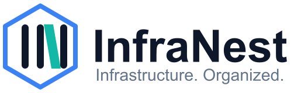

<p align="center">
  <picture>
    <source media="(prefers-color-scheme: dark)" srcset=".github/assets/infranest-logo-dark.svg">
    
  </picture>
</p>

<h1 align="center">infranest-action</h1>

<p align="center">
  <strong>InfraNest in your GitHub Actions workflow.</strong><br>
  Silence alerts while you deploy, pause a monitor, reset your sandbox: one step each.
</p>

<p align="center">
  <a href="https://github.com/InfraNest-Infrastructure-Organized/infranest-action/actions/workflows/ci.yml"></a>
  
  
</p>

---

A deploy restarts things, and a restart looks like an outage to your monitors. This action opens a
**maintenance window** in [InfraNest](https://infranest.io) before you deploy, so nobody is paged for it and your
status page says what is going on, and closes it again afterwards, even when the deploy fails.

## Quick start

```yaml
jobs:
  deploy:
    runs-on: ubuntu-latest
    steps:
      - uses: actions/checkout@v4

      - name: Silence alerts during the deploy
        id: window
        uses: InfraNest-Infrastructure-Organized/infranest-action@v1
        with:
          token: ${{ secrets.INFRANEST_TOKEN }}
          organization: ${{ vars.INFRANEST_ORG }}
          command: maintenance-open
          check-ids: 1201,1202
          name: Deploy of the web app
          minutes: 30

      - name: Deploy
        run: ./deploy.sh

      - name: Alerts back on
        if: always() && steps.window.outputs.window-id != ''
        uses: InfraNest-Infrastructure-Organized/infranest-action@v1
        with:
          token: ${{ secrets.INFRANEST_TOKEN }}
          organization: ${{ vars.INFRANEST_ORG }}
          command: maintenance-close
          window-id: ${{ steps.window.outputs.window-id }}
```

`if: always()` closes the window whether the deploy succeeded or failed. If the job is cancelled before it gets
there, the window still closes by itself after `minutes`.

## Set up

1. In InfraNest, open **My account → Developer** and create a token with **Monitoring → Write**, in the
   organization you deploy to. Nothing more: it then cannot touch your DNS or servers.
2. In your repository, add it as a secret named `INFRANEST_TOKEN` (**Settings → Secrets and variables → Actions**).
3. Add your organization's id as a variable named `INFRANEST_ORG`. It is under **Settings → Organization** in
   InfraNest.
4. Find the ids of the monitors to silence in InfraNest, or with `GET /organizations/{org}/monitoring-checks`.

Try it against your free **sandbox** first: create a test token there, use the sandbox's id as the organization,
and nothing reaches the internet. See the [sandbox guide](https://developers.infranest.io/sandbox).

## Commands

| `command` | What it does | Inputs it reads | Token needs |
|---|---|---|---|
| `maintenance-open` | Opens a maintenance window now, silencing alerts for the monitors and servers you list | `check-ids` and/or `server-ids`, `name`, `minutes` | Monitoring → Write |
| `maintenance-close` | Closes a window; alerts are back on at once | `window-id` | Monitoring → Write |
| `monitor-pause` | Pauses one monitor | `monitor-id` | Monitoring → Write |
| `monitor-resume` | Resumes it | `monitor-id` | Monitoring → Write |
| `sandbox-reset` | Puts your sandbox's sample data back, e.g. before an end-to-end test | none (`organization` is the sandbox's id) | a sandbox test token |

## Inputs

| Input | Required | Default | What it is |
|---|---|---|---|
| `token` | yes | | An InfraNest API token. Always pass it from a secret. |
| `organization` | yes | | Your organization's id. |
| `command` | yes | | One of the commands above. |
| `check-ids` | | | Monitors to silence, comma-separated. |
| `server-ids` | | | Servers to silence, comma-separated. |
| `name` | | `Deploy` | What the maintenance window is called. |
| `minutes` | | `30` | How long the window lasts at most. |
| `window-id` | | | The window to close. |
| `monitor-id` | | | The monitor to pause or resume. |
| `api-url` | | `https://api.infranest.io/api` | The API address. |

## Outputs

| Output | What it is |
|---|---|
| `window-id` | The window `maintenance-open` opened. Pass it to `maintenance-close`. |

## Safe by design

- **The token is masked** in the logs, and is only ever sent to the API address.
- **A retried step does not open a second window**: each run attempt sends its own `Idempotency-Key`.
- **No dependencies**: a short shell script using `curl` and `jq`, which every GitHub-hosted runner has. Read it in
  [`run.sh`](run.sh).
- **Kept in step with the API**: CI checks every call the action makes against InfraNest's published
  [API description](https://github.com/InfraNest-Infrastructure-Organized/infranest-openapi), every week.

## Versions

Use `@v1` to get fixes automatically, or pin a release such as `@v1.0.0`, or a commit SHA, if you prefer.
Releases are listed under [Releases](https://github.com/InfraNest-Infrastructure-Organized/infranest-action/releases).

## Use at your own risk

This action changes real things in your InfraNest organization with your token. You are responsible for what it is
asked to do, and for keeping the token safe; give it only the scopes it needs. It is provided "as is", without
warranty of any kind, under the [Apache License 2.0](LICENSE). Your use of InfraNest is governed by its
[Terms of Service](https://infranest.io/terms).

## Links

- [Developer documentation](https://developers.infranest.io) and the [API reference](https://developers.infranest.io/reference)
- [infranest-examples](https://github.com/InfraNest-Infrastructure-Organized/infranest-examples): the same jobs as scripts, in shell, Python, JavaScript and PowerShell
- [infranest-openapi](https://github.com/InfraNest-Infrastructure-Organized/infranest-openapi): the API description
- [infranest-mcp](https://github.com/InfraNest-Infrastructure-Organized/infranest-mcp): the MCP server, so your AI assistant can read your InfraNest account
- [Service status](https://status.infranest.io)

Found a problem? Open an [issue](https://github.com/InfraNest-Infrastructure-Organized/infranest-action/issues).
For a security issue in InfraNest, see [infranest.io/security](https://infranest.io/security).

## Licence

[Apache License 2.0](LICENSE).
